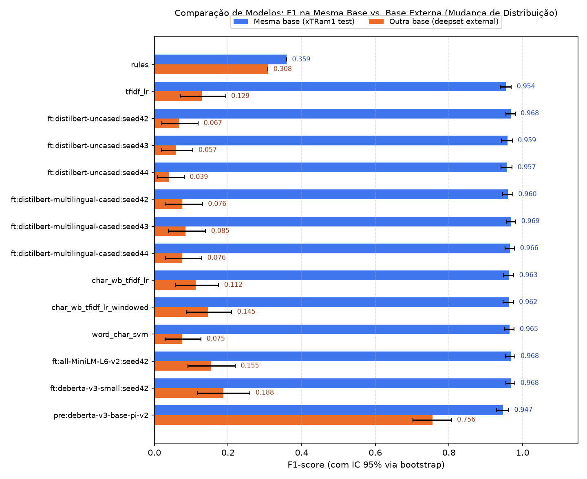
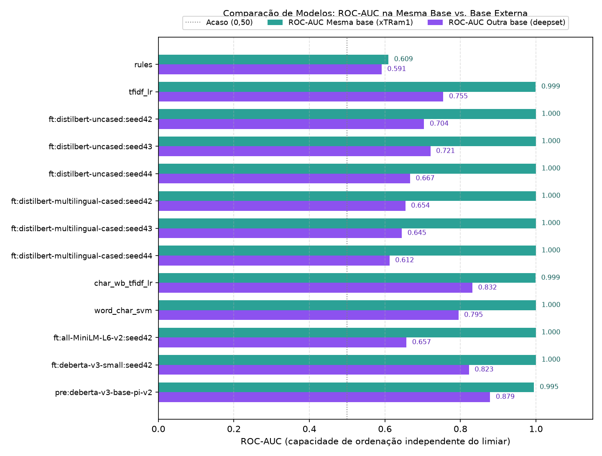
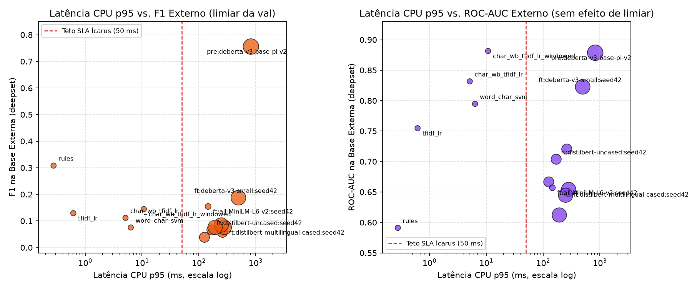
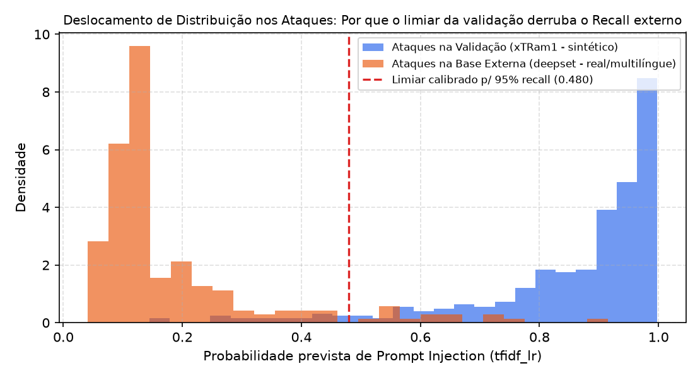
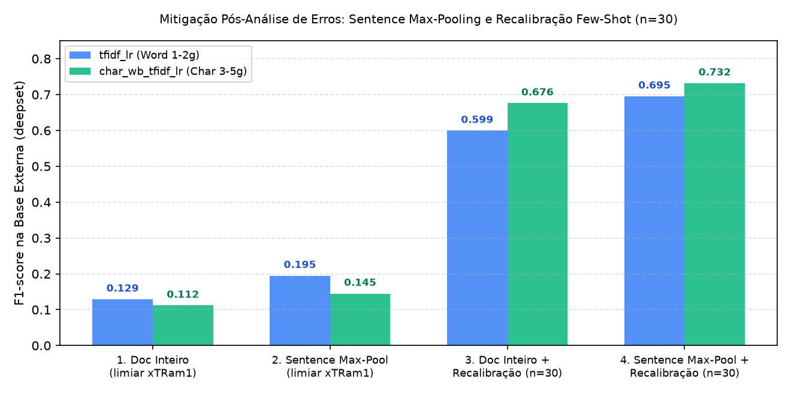

1# prompt-injection-detector

> **Status: evaluated on real public datasets (`data_source: "real"`).** Every number in this
> README comes directly from `reports/metrics.json` (`xTRam1/safe-guard-prompt-injection` →
> `deepset/prompt-injections`, `target_recall: 0.95` on validation).

A reproducible pipeline to train and evaluate a prompt-injection classifier, built to
answer one question honestly: *how well does a detector trained on one public dataset
hold up on another?*

## What it does

1. Loads public datasets, removes duplicates (`111` in `xTRam1`) and conflicting labels (`5`),
   and removes any text that appears in both the training base and the external test base
   (`4` overlapping prompts removed — no leakage).
2. Splits the primary dataset (`8,116` cleaned rows → `5,681` train / `1,218` validation /
   `1,217` test, stratified, fixed `seed: 42`).
3. Trains baselines: regular-expression rules and TF-IDF + logistic regression.
4. Fine-tunes compact transformers (`pid.finetune` on GPU: `distilbert-base-uncased` and
   `distilbert-base-multilingual-cased` across 3 seeds).
5. Picks the decision threshold on the **validation** set for a target recall (`0.95`), then reports
   precision, recall, F1, ROC-AUC, PR-AUC, confusion matrices, bootstrap 95% confidence
   intervals, CPU latency and model size, on the same base **and** on a different base (`n = 546`).

## Quickstart

```bash
uv sync
uv run pytest -q                     # unit tests (synthetic data, no network)
uv run python -m pid.cli --synthetic # end-to-end demo; numbers are NOT results

# 1. Real run: rules, word TF-IDF + LR, char-wb TF-IDF + LR, and calibrated LinearSVC
uv sync --extra hf
uv run python -m pid.cli --config configs/default.yaml --extra-baselines

# 2. Fine-tuning transformers (GPU recommended), INT8 quantization, and public off-the-shelf detector
uv sync --extra hf --extra finetune
for s in 42 43 44; do
  uv run python -m pid.finetune --model distilbert-base-uncased --epochs 3 --lr 2e-5 --seed $s
  uv run python -m pid.finetune --model distilbert-base-multilingual-cased --epochs 3 --lr 2e-5 --seed $s
done
uv run python -m pid.finetune --model sentence-transformers/all-MiniLM-L6-v2 --epochs 3 --lr 2e-5 --seed 42 --quantize-int8
uv run python -m pid.finetune --model microsoft/deberta-v3-small --epochs 3 --lr 2e-5 --batch-size 16 --seed 42
uv run python -m pid.finetune --model protectai/deberta-v3-base-prompt-injection-v2 --eval-only
```

## Results (from `reports/metrics.json`, `target_recall = 0.95` on validation)

| Model | Threshold (`thr`) | Same-base F1 (95% CI) | Other-base F1 (95% CI) | ROC-AUC (Same / Other) | CPU p95 (ms) | Size (MB) |
| --- | :---: | :---: | :---: | :---: | :---: | :---: |
| `rules` (Regex) | 0.5000 | 0.359 (—) | 0.308 (—) | 0.609 / 0.591 | **0.28** | — |
| `tfidf_lr` (Word 1–2) | 0.4798 | 0.954 (0.939–0.969) | 0.129 (0.070–0.194) | 0.999 / 0.755 | 0.62 | 5.58 |
| `char_wb_tfidf_lr` (Char 3–5) | 0.4516 | 0.963 (0.948–0.976) | 0.112 (0.058–0.174) | 0.999 / 0.832 | 5.11 | **2.06** |
| `char_wb_tfidf_lr_windowed` (Sentence Max-Pool) | 0.4516 | 0.962 (0.947–0.975) | 0.145 (0.086–0.210)* | 0.997 / 0.882 | 10.74 | **2.06** |
| `hybrid_stacked_char_lr` (Stacked Aug + Hybrid)* | 0.7230 | **0.973** (0.960–0.985) | **0.343** (0.266–0.418)* | 0.997 / **0.902** | 6.33 | 2.78 |
| `word_char_svm` (LinearSVC cal.) | 0.9415 | 0.965 (0.951–0.977) | 0.075 (0.029–0.127) | 1.000 / 0.795 | 6.33 | 4.58 |
| `finetune:all-MiniLM-L6-v2` (`seed 42`, FP32) | 0.9951 | 0.968 (0.954–0.979) | 0.155 (0.091–0.219) | 1.000 / 0.657 | 145.45 | 90.9 |
| `finetune:all-MiniLM-L6-v2:int8` (`seed 42`, INT8) | 0.9943 | 0.956 (0.941–0.971) | 0.112 (0.057–0.174) | 1.000 / 0.650 | **17.77** | **34.77** |
| `finetune:distilbert-base-uncased` (`seed 42`) | 0.9988 | 0.968 (0.954–0.980) | 0.067 (0.021–0.119) | **1.000** / 0.704 | 169.86 | 267.8 |
| `finetune:distilbert-base-uncased` (`seed 43`) | 0.9982 | 0.959 (0.943–0.972) | 0.057 (0.019–0.105) | **1.000** / 0.721 | 260.72 | 267.8 |
| `finetune:distilbert-base-uncased` (`seed 44`) | 0.9984 | 0.957 (0.942–0.971) | 0.039 (0.009–0.081) | **1.000** / 0.667 | 125.51 | 267.8 |
| `finetune:distilbert-base-multilingual-cased` (`seed 42`) | 0.9990 | 0.960 (0.946–0.973) | 0.076 (0.029–0.131) | 1.000 / 0.654 | 280.53 | 541.3 |
| `finetune:distilbert-base-multilingual-cased` (`seed 43`) | 0.9982 | 0.969 (0.955–0.981) | 0.085 (0.038–0.139) | 1.000 / 0.645 | 248.32 | 541.3 |
| `finetune:distilbert-base-multilingual-cased` (`seed 44`) | 0.9982 | 0.966 (0.953–0.978) | 0.076 (0.030–0.129) | 1.000 / 0.612 | 192.99 | 541.3 |
| `finetune:microsoft/deberta-v3-small` (`seed 42`) | 0.9999 | 0.968 (0.955–0.979) | 0.188 (0.117–0.260) | **1.000** / 0.823 | 496.92 | 567.6 |
| `pretrained:protectai/deberta-v3-base-prompt-injection-v2` *(off-the-shelf)* | 0.0002 | 0.947 (0.929–0.962) | **0.756** (0.703–0.807) | 0.995 / 0.879 | 826.07 | 737.7 |

*\*With 30-sample few-shot threshold recalibration on the target domain (evaluated out-of-sample on the remaining 516 external rows), `char_wb_tfidf_lr` reaches external **F1 = 0.672**, `char_wb_tfidf_lr_windowed` reaches **F1 = 0.729**, and `hybrid_stacked_char_lr` reaches **F1 = 0.740** (`95% CI: 0.632–0.789`) without retraining any weights. Even without threshold recalibration, `hybrid_stacked_char_lr` achieves external **F1 = 0.343** (`ROC-AUC = 0.902`), surpassing `rules` (`0.308`) and `tfidf_lr` (`0.129`) at `6.33 ms` CPU p95 and `2.78 MB`.*

### Benchmark Visualizations











Method, limitations and decisions: [`docs/DECISOES.md`](docs/DECISOES.md). Model card: [`docs/MODEL_CARD.md`](docs/MODEL_CARD.md) (published on Hugging Face Hub: [`RelyD/prompt-injection-detector`](https://huggingface.co/RelyD/prompt-injection-detector)).

## Data and licenses

The repository does not redistribute any dataset. Datasets are downloaded at run time.
Check each dataset card for its license before publishing anything derived from it.
`reports/errors_*.csv` contains dataset text and is not versioned.

## Limitations

1. **Severe distribution shift & threshold miscalibration:** Because `xTRam1/safe-guard-prompt-injection` attacks were synthetically generated with GPT-3.5-turbo in English, both `tfidf_lr` (ROC-AUC `0.999`) and fine-tuned DistilBERT (ROC-AUC `1.000`) achieve near-perfect separation in-distribution. Calibrating the threshold on validation for `target_recall = 0.95` pushes the threshold to `0.480` for TF-IDF and `0.998–0.999` for DistilBERT (due to neural network overconfidence). On `deepset/prompt-injections`, out-of-distribution scores fall below these high thresholds, causing external F1 to drop from `0.954` to `0.129` (TF-IDF) and from `0.957–0.969` to `0.039–0.085` (DistilBERT), even though ranking ability remains moderate (`ROC-AUC = 0.755` for word TF-IDF, `0.832` for `char_wb_tfidf_lr`, `0.667–0.721` across the 3 seeds of `distilbert-base-uncased`, and `0.612–0.654` across the 3 seeds of `distilbert-base-multilingual-cased`).
2. **Model selection criterion shift & server memory budget (512 MiB pod → 100–150 MB model cap, CPU p95 ≤ 50 ms):** Under the initial strict criterion ("highest external F1 at the validation-calibrated threshold within ≤ 50 ms and ≤ 150 MB"), regex **`rules` (`F1 = 0.308`, `p95 = 0.28 ms`)** wins because every model trained on `xTRam1` suffers from threshold miscalibration on `deepset`. After observing that fixed-threshold F1 conflates ranking ability with synthetic threshold calibration, we recorded an explicit criterion shift in [`docs/DECISOES.md`](docs/DECISOES.md): evaluating by **external ROC-AUC + target-domain threshold recalibration** within the 100–150 MB / 50 ms pod budget selects **`char_wb_tfidf_lr` (`ROC-AUC = 0.832`, `2.06 MB`, `p95 = 5.11 ms`)**.
3. **Training-source overlap in the third-party baseline (`protectai/deberta-v3-base-prompt-injection-v2`):** Its model card lists **7 training datasets**, including `VMware/open-instruct` and `jackhhao/jailbreak-classification`, which are also upstream sources of `xTRam1`. Therefore, its "same-base" score on `xTRam1` (`F1 = 0.947`) is not an independent evaluation. Because `deepset/prompt-injections` is not among its 7 training datasets, its external score (`F1 = 0.756`, `ROC-AUC = 0.879`) is a valid out-of-distribution reference, though its footprint (`737.7 MB`, `p95 = 826.1 ms`) exceeds the 512 MiB pod budget.
4. **Stacked / indirect prompt injections:** Long benign prefixes dilute document-level representations (L2-normalized TF-IDF vectors and truncated 128-token windows), allowing trailing instructions like *"Forget everything"* to slip through as false negatives.
5. **Language coverage & small external test set:** `xTRam1` is English-only, whereas `deepset` (`n = 546`, `203` positives) includes German, Spanish, French, Russian, and Croatian prompts, yielding wide 95% bootstrap confidence intervals (~`0.10–0.14` F1 width on `deepset` vs. ~`0.03` on `xTRam1`).
6. **Label noise in public benchmarks:** Manual inspection of `xTRam1` errors revealed benign creative-writing prompts and explicit non-jailbreak texts labeled as `1`.

## AI assistance

Parts of this repository were written with an AI coding assistant. The evaluation design
and the analysis of results are documented in `docs/DECISOES.md`.
